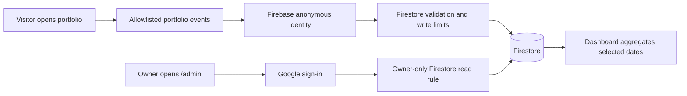

# Private admin dashboard and portfolio analytics

Updated: 23 October 2026. Implementation uses Firebase Spark (no billing account).
Owner: Google sign-in with **kanjal55567@gmail.com**. Address: **/admin**.

## Counting and source improvements — implemented 23 October 2026

The counting, source, browser-exclusion and report-control changes below are implemented. Google visitor identity remains an optional, unimplemented decision. Hosting remains the owner's Vercel project at `https://kajal-portfolio-brown.vercel.app`; no Sites publishing, new hosting account, or paid service is used. The owner must open the private exclusion link in each phone/browser they want excluded. The clean-start timestamp is deliberately unset until the owner configures those devices and chooses **Start clean tracking now**; old records are preserved.

The resume headline now counts distinct browsers (**Resume visitors**); total resume clicks remain visible separately. A resume click after session expiry no longer fabricates a page-view event. Contact labels explain form focus, accepted sends and failed sends. Session creation uses Web Locks when available. Reports consistently filter excluded browser IDs, support an exact clean-start timestamp, and attribute each session to one source/device. Only normalized `source`/`sourceKind` values and the hostname are stored; other campaign values are discarded.

### 1. Make the visitor count understandable

The existing implementation already deduplicates Firebase anonymous visitor IDs across the selected date range. Refreshes do not normally add unique visitors. The current six visitors include verification activity and cannot be assumed to be six outside people.

Keep three clearly explained metrics:

| Metric | Definition | Example from one tracked browser |
| --- | --- | --- |
| Unique visitors | Estimated distinct browsers in the selected dates | Five openings still count as one visitor while its ID persists |
| Visits | Sessions separated by at least 30 minutes without tracked activity | Returning after that interval adds a visit, not a visitor |
| Page views | Recorded page openings, refreshes, and Home/Stats navigation | Refreshing five times adds page views |

Add a short inline explanation beside the cards and a concrete example. Keep the existing browser ID across ordinary refreshes, tabs, and return visits; do not create an ID per page view. Verify that all cards deduplicate retries consistently. Fix session-start races between simultaneously opened tabs if the tests reproduce them.

Limits must remain visible: another device, a separate browser/profile, an in-app browser, cleared storage, private browsing, and the existing 90-day identity rotation can produce another ID. Shared browsers can combine several people. Browser privacy preferences and blockers can prevent counting. Do not describe the result as an exact count of humans or promise lifetime deduplication. IP addresses and browser fingerprints will not be used to guess which IDs belong to the same person.

### 2. Exclude the owner and development/testing visits

- Preserve automatic exclusion after successful owner sign-in. Show **This browser is excluded from visitor counts** in `/admin`, with an explanation that exclusion applies only to that browser on this site.
- Provide an owner-facing setup link using `?analytics=off` to exclude another browser before any analytics ID or event is created. Process this before starting the collector, persist the opt-out locally, and remove the setup parameter from the displayed URL. This flag affects collection only and never grants admin access. Keep the setup link separate from public social sharing links.
- Apply exclusion on the owner's phone browser and desktop browser separately. Switching apps or clearing site storage can require setting it again.
- Continue excluding localhost, preview deployment hosts, `/admin`, previous declines and browser privacy signals. Normal QA uses local fixtures or previews. Any live testing browser must be excluded before opening the public page; a deliberate analytics round-trip test must be recorded as a known test and excluded from audience reports.
- Add an owner-only, reversible exclusion list for known test visitor IDs. Filter these IDs consistently from every report. Do not guess that unknown historical visitors were tests or delete their events.
- Offer a clearly dated **Since clean tracking started** filter after the owner's devices are configured. Preserve earlier history with a notice that it includes setup/testing. Do not silently reset the six visitors or present old totals as clean audience data.

The agent's visits can currently count when it uses an ordinary, non-excluded production browser. There is no reliable automatic way to recognize an AI-operated browser as such; exclusion must be established before browsing.

### 3. Improve Instagram, Facebook and other source reporting

Today the app reads `document.referrer` and retains only its hostname. For example, `m.facebook.com` and `l.instagram.com` come from the browser's navigation information; the app does not read Facebook or Instagram accounts. An absent referrer means **Direct / unknown**, not proof that someone typed the address.

Add a source resolver with this order at the start of each session:

1. A recognized campaign tag in the landing URL.
2. A recognized referring hostname.
3. Another external referring hostname, or **Direct / unknown** if none exists.

Normalize known domains into Instagram, Facebook, LinkedIn, GitHub and Google. Keep platform matching exact or restricted to genuine subdomains. Label evidence as **Tagged link**, **Browser referrer**, or **Unknown**. Source attribution is an estimate: tags can be copied or edited, and browsers/apps may omit referrers. Never invent the missing source or a referring person's identity.

Prepare these links for the owner to place in the corresponding profiles; do not edit or publish social profiles automatically:

- Instagram: `https://kajal-portfolio-brown.vercel.app/?utm_source=instagram&utm_medium=social&utm_campaign=portfolio`
- Facebook: `https://kajal-portfolio-brown.vercel.app/?utm_source=facebook&utm_medium=social&utm_campaign=portfolio`
- LinkedIn: `https://kajal-portfolio-brown.vercel.app/?utm_source=linkedin&utm_medium=social&utm_campaign=portfolio`

Record the source once per session and retain it through internal navigation and refreshes. A subsequent session can have a different source without creating another unique visitor. Display source totals as **Visits by source** so they reconcile with session counts. Historical events retain their available hostname evidence; do not backfill campaign tags that were never recorded.

Store only normalized, allowlisted campaign values and the hostname. Do not store entire landing URLs, arbitrary query parameters, emails in tags, or referral paths. This uses the existing Firebase implementation; Google Analytics is not required.

### 4. Gmail/name identification is a separate optional decision

A normal portfolio visit does not reveal the visitor's Gmail address or Google name, even if they are signed into Google in that browser. Google sign-in can share identity after the visitor authorizes it. It does not grant access to the contents of Gmail.

Recommendation for this portfolio: keep browsing open without a visitor login or name form, as previously requested. Implement counting, exclusions and source improvements first. No visitor identity collection is authorized for implementation by this plan alone.

If the owner later chooses an optional **Continue with Google** flow:

- Explain that the visitor is sharing their account name/email and whether their subsequent portfolio activity will be associated with it; allow anonymous browsing to continue.
- Verify identity through Firebase/Google tokens, never a browser-supplied email field. Use a verified stable account identifier for deduplication rather than the display name or email text. A person can still have multiple accounts, and an account may be shared.
- Keep **Recognized accounts** and **Anonymous browsers** as separate metrics. Do not add them together and call the sum unique people; anonymous and authenticated activity can overlap.
- Store an optional profile separately from event records, with owner-only reads, controlled profile access/deletion, and minimal identity fields. Do not request Gmail message scopes or associate contact-form details with browsing automatically.
- Redesign visitor auth separately from owner authorization: the current `ownerSignIn` rejects non-owner accounts, `visitorIdentity` skips non-anonymous accounts, and current Firestore event rules accept anonymous writers only. Do not open the admin role to visitors. Account linking and historical activity association require an explicit, explained flow and tests.

### 5. Implementation sequence and acceptance checks

1. Update collector/exclusion bootstrap, session/source metadata, event types, aggregation and dashboard explanations. Reuse Firebase Spark and existing browser IDs.
2. Extend Firestore validation for bounded source metadata and owner-only report settings/exclusions, while retaining existing owner authorization and write limits. Support existing events without new fields; deploy compatible rules before the new client.
3. Test in fixtures/emulator: five refreshes = one visitor; two sessions = one visitor/two visits; separate browsers remain separate; retry IDs do not add counts; owner/test exclusion prevents all writes; privacy opt-outs remain honored; exclusion lists affect all reports consistently.
4. Check tagged Instagram/Facebook links, known referrer domains, copied tags, missing referrers, internal navigation, and malicious/arbitrary parameters. Confirm source totals count sessions exactly once and unknown sources remain unknown.
5. Verify mobile admin explanations and exclusions, establish a visible clean-tracking start date, then deploy only to the existing Vercel project after implementation is requested. Verify with excluded browsers; any deliberate test write must be identifiable and filtered from audience counts.

Reference documentation: [Google sign-in and consent](https://developers.google.com/identity/gsi/web/guides/overview), [verified account identifiers](https://developers.google.com/identity/gsi/web/guides/verify-google-id-token), [browser referrers](https://developer.mozilla.org/en-US/docs/Web/API/Document/referrer), and [campaign URL parameters](https://support.google.com/analytics/answer/10917952?hl=en).

## What you will see

A dashboard in the portfolio's cream, brown and olive theme, with:

- Estimated unique tracked browsers, visits, page views, resume visitors and total resume clicks.
- Daily traffic and Home, About, Work, Contact and Stats visibility.
- Project card views, details opened, website clicks and code clicks.
- Contact starts, submissions accepted by FormSubmit, and failed submissions.
- Grouped source labels with attribution evidence, device categories and eight recent pseudonymous visit journeys.
- Today, 7, 30 (default), 90 days and custom ranges up to 90 days. All dates use India time.

Counts begin automatically on the approved production hostname when tracking is enabled. There is no consent prompt. Historical traffic cannot be recovered. Visibility does not prove reading; link clicks do not prove downloads or activity on another website. Contact analytics never contain names, emails or message text. Random browser/session identifiers cannot reveal who a visitor is; contact-form details stay separate from analytics.

## Architecture

Keep React, TypeScript and Vite. Use **Firebase Authentication + Cloud Firestore** in project `kajal-portfolio-analytics`. No Cloud Functions, Supabase, separate MongoDB/Postgres server, or Google Analytics SDK is needed.

Firebase Spark has free quotas, not unlimited usage. Do not enable Blaze or attach billing for this implementation. The public portfolio is hosted on the owner's Vercel project. Preview deployments remain excluded from visitor tracking.

## Access and data rules

- `/admin` is separate from public GitHub Stats and absent from the public navbar.
- Google sign-in requests identity only; no Gmail or Drive access.
- Firestore reads require a Firebase-verified Google sign-in token with `email_verified = true` and the exact owner email. A browser flag alone cannot authorize reads.
- Other Google users may authenticate but cannot read analytics; the UI rejects them.
- Tracked visitors receive a pseudonymous Firebase anonymous UID automatically. They can write validated events, never read other events or edit/delete history.
- Exact event fields, targets, devices, timestamp bounds and referrer hostname format are enforced by Firestore rules. Extra fields are rejected.
- Event IDs are immutable; identical network retries do not create extra events.
- Each anonymous UID has an atomic limit of 60 event writes per minute and 20 per batch. This is basic abuse protection: a determined caller can create new anonymous identities. Firebase App Check adds origin/app attestation when configured and enforced; it is not proof of a human visitor.
- Default-deny rules protect every unrelated collection. `tests/firestore-rules.test.mjs` validates authorization and write limits in an isolated emulator.

## Measurement definitions

A visit ends after 30 minutes without a tracked event. A tracked browser is its pseudonymous Firebase UID; private browsing, storage clearing, multiple devices and 90-day identity rotation affect estimates. Unique browsers across a date range are deduplicated across days.

A section/card view requires at least half the element or half the viewport height (whichever is smaller) to be visible for one second while the tab is visible. Views are deduplicated per page view; dashboard section/project totals count unique sessions. Project details and link clicks count actions. Resume visitors count distinct browser IDs, with total clicks separate. Contact form openings (a field received focus) are deduplicated per session. Accepted submissions mean the form provider accepted the request, not independently verified inbox delivery. A new session begun by a resume click does not add a page view.

Only fixed page, section, project and action identifiers are collected. Referrers store hostnames, never paths, search queries or URL fragments. Device class uses viewport width. No geolocation, IP address, message text, full user agent, screen recording or fingerprint is collected by the app. Firebase and its attestation provider process network metadata under their own service policies.

## Automatic collection and exclusions

The owner requested automatic basic activity tracking on 23 October 2026. The consent banner and footer preferences button are removed. Collection is enabled in the public configuration for the approved production hostname. Browser Do Not Track / Global Privacy Control disables tracking, and any earlier stored decline is still honored. A privacy preference detected during an in-flight identity request stops event delivery and signs out that anonymous identity. This change does not identify visitors or link their activity to contact-form details.

Localhost, /admin, unapproved hostnames and a browser that has signed in as owner are excluded. Admin sign-in and reads still use Firebase, independently of visitor tracking.

## Cost, performance and retention

The Firebase SDK loads separately from the normal portfolio bundle when an eligible visitor sends events or the owner opens /admin. Events are batched; failures never break navigation, contact delivery or project links. The admin reads selected dates on load/refresh rather than continuously streaming.

Reads paginate in batches of 500 with a 10,000-event safety limit; the dashboard asks for a smaller range instead of showing partial totals. Each refresh consumes Firestore read quota, and each event/budget transaction consumes write/read quota. Monitor the Firebase Usage page. If Spark quotas are exhausted, analytics may stop until quotas reset; the portfolio continues working.

**Retention is manual in this Spark version.** The dashboard supports ranges up to 90 days, but that filter does not delete older data. No automatic 90-day deletion or 12-month rollup is claimed. Firestore TTL/scheduled cleanup is not enabled because it can require billing. Review stored data periodically and use a trusted, scoped maintenance script after deciding the deletion period. Never expose delete privileges to visitor clients.

## Rollout checks

1. Register the web app and use public Firebase configuration; never put a service-account key in browser code.
2. Enable Google and Anonymous Auth and authorize only the portfolio hostname and required local development origins.
3. Create a Firestore Standard database in Mumbai (`asia-south1`) with production rules.
4. Run model/contact/GitHub regression tests and the Firestore authorization tests; deploy the exact checked rules.
5. Configure Firebase App Check for production and deploy its public site key in monitoring mode. Verify valid requests before enforcing it.
6. Verify the owner login, real empty dashboard, responsive layouts and direct /admin route. Test another account and unauthenticated reads in the emulator.
7. Automatic collection is enabled for the exact production hostname. A controlled live event round trip was verified on Vercel on 23 October 2026; initial totals include verification activity.
8. Deploy only to the owner's existing Vercel project, then check deployment status and the canonical production URL. Do not publish with Sites.

## Sources

- [Firebase pricing plans](https://firebase.google.com/docs/projects/billing/firebase-pricing-plans)
- [Firestore locations](https://firebase.google.com/docs/firestore/locations)
- [Google sign-in](https://firebase.google.com/docs/auth/web/google-signin)
- [Firestore access conditions](https://firebase.google.com/docs/firestore/security/rules-conditions)
- [Firebase App Check](https://firebase.google.com/docs/app-check/web/recaptcha-provider)

The earlier Supabase proposal is replaced by this Firebase approach. Supabase reported India network access restored on 3 March 2026; choosing Firebase here is about a small integrated setup, not an assumption of a permanent ban. [Supabase update](https://supabase.com/blog/navigating-regional-network-blocks)
