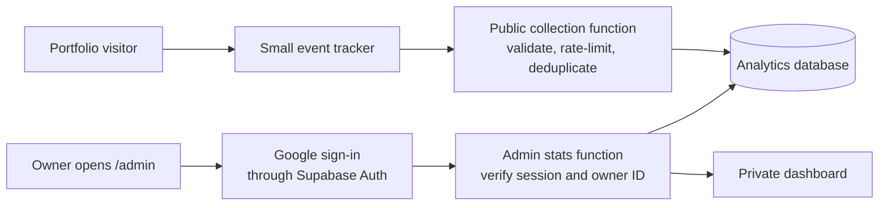

# Private admin dashboard and portfolio analytics

**Status:** Plan only — no tracking, sign-in, database, or admin page has been enabled.
**Prepared:** 23 October 2026
**Confirmed owner:** Google sign-in with `kanjal55567@gmail.com`
**Requested address:** `/admin`

## 1. What you will be able to see

Open your portfolio address followed by `/admin`, sign in with your Google account, and see a dashboard in the existing cream, brown, and olive theme.

| Question | Dashboard answer |
| --- | --- |
| How many people opened my portfolio? | Estimated unique visitors and visits within the selected dates |
| What did they look at? | Views of Home, About, Work, Contact, and the separate Stats page |
| Which projects attracted attention? | Project card views, details opened, live-site clicks, and code-link clicks |
| Did they open my resume? | Resume-link clicks |
| Did they try to contact me? | Contact form starts, accepted submissions, and failed submissions |
| Where did visits come from? | Referring website domains, plus “Direct / unknown” |
| What devices did they use? | Mobile, tablet, and desktop breakdown |

These are measurements of tracked browsers and actions, not identified people. A card visible on screen does not prove someone read it. A resume click does not prove the PDF was read or downloaded. Activity inside an external project, GitHub, or LinkedIn is outside this portfolio's measurement.

Counts start when tracking launches. Past visits cannot be reconstructed from the current app.

## 2. Dashboard layout and daily use

Default date range: **Last 30 days**. Other choices: Today, Last 7 days, Last 90 days, and a custom range within the retained event history. Dates display in **Asia/Kolkata (India time)**; stored timestamps use UTC.

```text
Portfolio analytics                         Date range | Refresh | Sign out

Tracked visitors       Visits       Page views       Resume opens
       —                 —              —                  —

Daily traffic chart                  Sections viewed
                                     About / Work / Contact / Stats

Projects                             Referrers and devices
Project | Viewed | Details | Clicks

Contact activity                     Recent anonymous visit journeys
Started | Accepted | Failed           Home → About → Work → Resume
```

The dashes above are layout placeholders, not sample analytics. The finished dashboard starts with an honest empty state until real events arrive.

- Project and section tables show unique visits as well as action totals where useful, so repeated clicks are not mistaken for extra people.
- A recent journey uses a short anonymous session label, time, and event sequence. It has no visitor name, email, or exact location.
- Date filters apply consistently to every chart and table. Show the time of the last successful refresh.
- Keep admin access out of the public navbar. Bookmark `/admin`; retain the existing public **Stats** link for GitHub activity.
- On mobile, stack summary cards and charts; allow wide tables to scroll inside their panels. Include loading, empty, expired-session, access-denied, and service-error states.

## 3. Recommended architecture

Retain the current **React + TypeScript + Vite** website. Add **Supabase Auth, Postgres, and Edge Functions** for the features that need a backend. This is a proposed implementation choice; no Supabase project has been connected yet.

The existing frontend has no application login or analytics database. A hidden page or a browser-only password check would not protect its data. Supabase supports Google sign-in, backend functions, and database access policies. [Google sign-in documentation](https://supabase.com/docs/guides/auth/social-sign-in/auth-google), [database access policies](https://supabase.com/docs/guides/database/postgres/row-level-security).



The collector accepts limited analytics events. The admin function returns analytics only after checking the owner. They have separate permissions; a public collection endpoint never exposes stored events.

## 4. Owner-only access

1. Configure Google OAuth through Supabase with only identity scopes: `openid`, email, and profile. Gmail inbox access is not needed.
2. Use the PKCE sign-in flow and a dedicated `/auth/callback` page. Allow only exact development and production redirect URLs. The callback exchanges the code, removes it from the URL, and goes to `/admin`. [OAuth and callback setup](https://supabase.com/docs/guides/auth/social-sign-in/auth-google).
3. Restrict new accounts to `kanjal55567@gmail.com` using a backend allowlist / Before User Created hook. Disable unused sign-in providers. The hook is an extra admission check, not the only authorization check. [Before User Created hook](https://supabase.com/docs/guides/auth/auth-hooks/before-user-created-hook).
4. After the owner's first verified Google sign-in, bind the verified account's immutable Supabase user ID as the admin ID. Bootstrap this through trusted server configuration, never by accepting a user-supplied role or ID.
5. Every admin request verifies the session token and compares its user ID with that configured owner ID. An absent or expired token returns 401; another valid account returns 403. Never trust an email or `isAdmin` flag sent by the browser. [Authenticated Edge Function calls](https://supabase.com/docs/guides/functions/auth).
6. Enable Row Level Security on analytics tables. Owner-only SELECT policies and restricted aggregate functions protect reads; ordinary users and anonymous callers cannot insert, edit, or delete analytics directly. The collector alone receives server-side write privileges. [Row Level Security](https://supabase.com/docs/guides/database/postgres/row-level-security).
7. Sign-out clears the dashboard's cached data. Expired sessions return to sign-in without flashing private data. Admin responses use `Cache-Control: private, no-store`; no analytics are bundled into static HTML or public JSON.

Anyone who guesses `/admin` may reach the sign-in screen; they still cannot load dashboard data. Hiding the URL is not the access control.

Keep Google client secrets and privileged database keys in the backend's secret configuration. Only the Supabase URL and publishable key belong in the frontend. Add `.env*` ignore rules before creating local secret files, with an explicit exception for a placeholder-only `.env.example`. [Function environment variables](https://supabase.com/docs/guides/functions/secrets).

## 5. What counts as an event

| Event | Trigger and counting rule |
| --- | --- |
| `page_view` | Once on the initial rendered public page and each actual page transition between the portfolio and GitHub Stats. Scrolling to About or Work is not another page view. |
| `section_view` | A meaningful portion of a section is visible for at least one continuous second while the tab is visible; once per section per page view. |
| `project_view` | A project card meets the same visibility rule; once per project per page view. |
| `project_details_open` | A project details dialog opens; record its stable project ID. |
| `project_link_click` | A project website or code button is activated; record project ID and a fixed destination category. |
| `resume_open` | The resume link is activated. Label this “Resume opens / clicks,” never confirmed downloads. |
| `social_click` | A GitHub or LinkedIn link is activated; record platform and placement. |
| `contact_start` | First interaction with the contact form in a visit; record no field contents. |
| `contact_submit_accepted` | The existing FormSubmit handler receives its validated acceptance response. This is not proof of inbox delivery. |
| `contact_submit_failed` | The existing handler reports failure; use a fixed error category, never raw response text or message contents. |

Use `IntersectionObserver` plus a visibility timer for section and card exposure. To handle tall sections on phones, use a visible-height target of `min(50% of element height, 50% of viewport height)` rather than requiring half of a very tall section to fit on screen. Pause/reset the timer when hidden or out of view. [Intersection Observer API](https://developer.mozilla.org/en-US/docs/Web/API/Intersection_Observer_API).

Keep canonical page and project IDs in event data. Never copy arbitrary URLs, OAuth query strings, page text, or contact inputs into the event payload.

## 6. Visitor counts, privacy, and accuracy

- Proposed first version: an optional analytics preference, off until accepted. Declining keeps the portfolio fully usable. The dashboard labels its audience **Tracked visitors** so it does not imply coverage of every visit.
- After acceptance, create a random first-party browser ID with a 90-day expiry. This is a pseudonymous identifier, not a person's identity. A new device, private window, cleared storage, or expired ID can count as a new visitor.
- A visit/session ends after 30 minutes of inactivity. Reopening within that window uses the same session; viewing several pages can increase page views without increasing visits.
- Unique visitors = distinct browser IDs with accepted events in the selected range. Visits = distinct session IDs in that range. Do not sum daily unique counts to calculate monthly unique visitors.
- Store only coarse device class and referrer hostname. Do not retain raw IP addresses in analytics, full user-agent strings, search terms, full referrer URLs, contact details, or keystrokes. No session replay or fingerprinting in this plan.
- Provide a way to withdraw analytics consent and clear the local analytics identifiers. Respect supported browser privacy signals as an opt-out.
- Exclude `/admin`, `/auth/callback`, localhost, preview/test traffic, and the owner's opted-out browser from production totals. Owner visits from a different, signed-out browser cannot automatically be recognized.
- Blockers, declined tracking, network failures, and bot traffic mean these are estimates. The public collector can reduce fake events, but it cannot prove that every event is human.
- Retain detailed events for 90 days and non-identifying daily totals for 12 months. Recent journey inspection is limited to the detailed-event window. Longer-term totals must not claim deduplicated annual visitors after the identifiers are deleted.

These are proposed product defaults to review before enabling collection, not a claim of universal legal compliance.

## 7. Backend and data design

| Item | Planned fields / behavior |
| --- | --- |
| `analytics_events` | Unique event UUID, schema version, server receive time, browser ID, session ID, page-view ID, event name, allowlisted page/section/project ID, destination category, referrer host, device class |
| `analytics_daily` | Date, event/target dimensions, aggregate counts; no visitor identifiers or journey data |
| Owner configuration | Verified admin user ID and owner email; no browser-writable role assignment |
| `track` function | Public POST endpoint, with strict event schema, field lengths, payload size, and timestamp bounds; returns no analytics |
| `admin-stats` function | Authenticated endpoint with owner verification, bounded date ranges, aggregation, and paginated recent journeys |
| Retention job | Aggregate eligible totals and remove expired raw events; run only after the implementation is approved and deployed |

The function URLs would live under the connected Supabase project's `/functions/v1/` path; `/admin` remains on the portfolio domain. We are not assuming that the current static host can execute an `/api` backend.

For collection, allow known site origins, reject unknown event types, limit batch sizes, and enforce shared server-side rate limits. Origin/CORS checks alone are not authentication. Use short-lived hashed abuse keys if IP-derived rate limiting is needed, with no raw IP stored in event rows or application logs. Validate provider logging defaults during setup.

Generate event IDs once and enforce uniqueness in the database so retries do not inflate counts. Batch small requests, use a bounded retry queue, and never delay navigation or contact submission for analytics. Keep tracking initialization safe under React StrictMode, component remounts, browser Back/Forward, and reconnects.

Admin queries use the owner's verified identity and database policies. Privileged write credentials are confined to the collector and maintenance tasks; do not use a privileged key to bypass authorization in the dashboard.

## 8. Changes needed in this repository

The current source is authoritative; the older `PLAN.md` and portions of `README.md` describe a previous layout.

| File / area | Planned change |
| --- | --- |
| `src/main.tsx` | Dispatch `/admin` and `/auth/callback` by pathname and lazy-load the admin bundle; retain existing public routes |
| `src/admin/` | Sign-in screen, owner guard, dashboard, charts, filters, empty/error states, and mobile styles |
| `src/lib/analytics.ts` | Typed event interface, consent-aware IDs, session rules, deduplication, and bounded delivery queue |
| `src/lib/supabase.ts` | Public client configuration and OAuth/session handling |
| `src/App.tsx` | Public page views and section exposure; resume-link event |
| `src/components/project-showcase.tsx` | Project visibility, details, website, and code-link events |
| `src/components/contact-section.tsx` | Anonymous contact actions without changing the working email-delivery behavior |
| `src/components/portfolio-footer.tsx` | Relevant outbound-link events and analytics preference entry |
| `supabase/migrations/` | Tables, indexes, permissions, owner policies, aggregate queries, and retention setup |
| `supabase/functions/` | Event collector and protected admin query function |
| Build / hosting configuration | Ensure direct `/admin` and `/auth/callback` navigation and refresh work in production |
| `.gitignore`, `.env.example`, `README.md` | Secret handling, setup instructions, event definitions, and operations notes |

Current public navigation uses hash fragments, including `#/github`. `/admin` must be a real pathname, not `#/admin`. Verify hosting support for a SPA fallback; if unavailable, emit dedicated `admin/index.html` and `auth/callback/index.html` entry files referencing the built assets. Test slash normalization, direct links, and OAuth callbacks on the deployed host before launch.

## 9. Delivery phases

1. **Set up the backend:** select the owner's Supabase and Google Cloud projects, configure Google OAuth and callback URLs, establish the owner account, and apply database policies.
2. **Build private access first:** implement `/admin`, the callback, sign-out, and protected query endpoint. Prove another account and anonymous requests cannot read any analytics before collecting real visits.
3. **Add event collection:** instrument the agreed events, analytics preferences, session boundaries, rate limits, and deduplication. Use isolated test events first.
4. **Build the dashboard:** implement the layout above with real queries and consistent date filters. Preserve the portfolio's theme and mobile behavior.
5. **Verify and launch:** run authorization and counting checks, confirm production deep links, inspect real test journeys, enable collection on the intended production audience, and document maintenance.

No account creation, paid subscription, new public sharing, or tracking activation is part of this planning step.

## 10. Setup decisions and dependencies

| Decision | Status |
| --- | --- |
| Admin login | **Confirmed:** Google, `kanjal55567@gmail.com` |
| Admin path | **Confirmed:** `/admin` |
| Backend | **Recommended:** Supabase; requires an owner-controlled project and Google OAuth configuration |
| Dashboard scope | **Proposed:** anonymous traffic, content engagement, and outbound/contact actions |
| Tracking preference and retention | **Proposed:** opt-in analytics, 90-day detailed events, 12-month aggregate totals |
| Production domain and audience | Confirm before launch; the currently published Sites project is owner-private |

The current Sites access gate and the proposed Google admin login are separate. A private site cannot measure visits from the general public. Public launch requires deliberately choosing the portfolio audience while keeping all admin data behind the Google owner check; this plan does not change the current sharing settings.

For development, evaluate the Supabase free tier first. Its current limits include 500 MB database storage and inactivity pausing; assess expected event volume and availability before choosing production hosting. No paid tier is assumed or purchased. [Supabase pricing](https://supabase.com/pricing).

## 11. Acceptance checks

- The confirmed Google account can enter `/admin`; a different account, missing/expired token, forged claims, and direct database requests cannot read dashboard data.
- Direct `/admin` loads, refreshes, and OAuth callbacks work on the actual host. The portfolio and `#/github` still work as before.
- One controlled journey produces one visit, the expected page/section/project events, and the correct resume/contact actions. Repeat delivery of the same event UUID adds nothing.
- Oversized or malformed events and excessive requests are rejected without breaking the portfolio. Unknown properties and contact text never enter analytics storage.
- Tab hiding, tall mobile sections, rapid navigation, repeated component mounts, and 30-minute session expiry behave according to the counting rules.
- Date boundaries and totals match India time; monthly unique visitors are computed from distinct identifiers, not summed daily counts.
- Declined tracking emits no analytics and creates no visitor ID. Opt-out, development traffic, and admin pages are excluded.
- Empty, delayed, and failed responses are shown honestly; the dashboard never substitutes fabricated numbers. All main views work on mobile and with keyboard navigation.
- Production output contains no privileged secrets. Retention and owner authorization remain enforced independently of the frontend.

**Completion means:** you can open `/admin`, sign in with the confirmed Google account, and understand how tracked visitors use your portfolio, while other visitors cannot access that analytics data.
