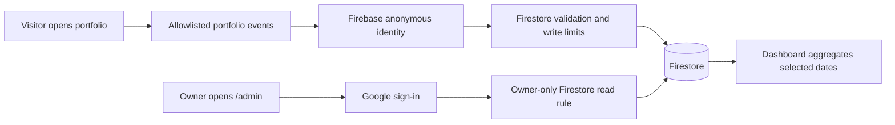

# Private admin dashboard and portfolio analytics

Updated: 23 October 2026. Implementation uses Firebase Spark (no billing account).
Owner: Google sign-in with **kanjal55567@gmail.com**. Address: **/admin**.

## What you will see

A dashboard in the portfolio's cream, brown and olive theme, with:

- Estimated unique tracked browsers, visits, page views, and resume opens.
- Daily traffic and Home, About, Work, Contact and Stats visibility.
- Project card views, details opened, website clicks and code clicks.
- Contact starts, submissions accepted by FormSubmit, and failed submissions.
- Referring domains, device categories and eight recent pseudonymous visit journeys.
- Today, 7, 30 (default), 90 days and custom ranges up to 90 days. All dates use India time.

Counts begin automatically on the approved production hostname when tracking is enabled. There is no consent prompt. Historical traffic cannot be recovered. Visibility does not prove reading; link clicks do not prove downloads or activity on another website. Contact analytics never contain names, emails or message text. Random browser/session identifiers cannot reveal who a visitor is; contact-form details stay separate from analytics.

## Architecture

Keep React, TypeScript and Vite. Use **Firebase Authentication + Cloud Firestore** in project `kajal-portfolio-analytics`. No Cloud Functions, Supabase, separate MongoDB/Postgres server, or Google Analytics SDK is needed.

Firebase Spark has free quotas, not unlimited usage. Do not enable Blaze or attach billing for this implementation. The static host's audience remains as previously configured. A private hosted preview cannot measure unrestricted public traffic.

## Access and data rules

- `/admin` is separate from public GitHub Stats and absent from the public navbar.
- Google sign-in requests identity only; no Gmail or Drive access.
- Firestore reads require a Firebase-verified Google sign-in token with `email_verified = true` and the exact owner email. A browser flag alone cannot authorize reads.
- Other Google users may authenticate but cannot read analytics; the UI rejects them.
- Tracked visitors receive a pseudonymous Firebase anonymous UID automatically. They can write validated events, never read other events or edit/delete history.
- Exact event fields, targets, devices, timestamp bounds and referrer hostname format are enforced by Firestore rules. Extra fields are rejected.
- Event IDs are immutable; identical network retries do not create extra events.
- Each anonymous UID has an atomic limit of 60 event writes per minute and 20 per batch. This is basic abuse protection: a determined caller can create new anonymous identities. Firebase App Check adds origin/app attestation when configured and enforced; it is not proof of a human visitor.
- Default-deny rules protect every unrelated collection. `tests/firestore-rules.test.mjs` validates authorization and write limits in an isolated emulator.

## Measurement definitions

A visit ends after 30 minutes without a tracked event. A tracked browser is its pseudonymous Firebase UID; private browsing, storage clearing, multiple devices and 90-day identity rotation affect estimates. Unique browsers across a date range are deduplicated across days.

A section/card view requires at least half the element or half the viewport height (whichever is smaller) to be visible for one second while the tab is visible. Views are deduplicated per page view; dashboard section/project totals count unique sessions. Project details and link clicks count actions. Contact starts are deduplicated per session. Accepted submissions mean the form provider accepted the request, not independently verified inbox delivery.

Only fixed page, section, project and action identifiers are collected. Referrers store hostnames, never paths, search queries or URL fragments. Device class uses viewport width. No geolocation, IP address, message text, full user agent, screen recording or fingerprint is collected by the app. Firebase and its attestation provider process network metadata under their own service policies.

## Automatic collection and exclusions

The owner requested automatic basic activity tracking on 23 October 2026. The consent banner and footer preferences button are removed. Collection is enabled in the public configuration for the approved production hostname. Browser Do Not Track / Global Privacy Control disables tracking, and any earlier stored decline is still honored. A privacy preference detected during an in-flight identity request stops event delivery and signs out that anonymous identity. This change does not identify visitors or link their activity to contact-form details.

Localhost, /admin, unapproved hostnames and a browser that has signed in as owner are excluded. Admin sign-in and reads still use Firebase, independently of visitor tracking.

## Cost, performance and retention

The Firebase SDK loads separately from the normal portfolio bundle when an eligible visitor sends events or the owner opens /admin. Events are batched; failures never break navigation, contact delivery or project links. The admin reads selected dates on load/refresh rather than continuously streaming.

Reads paginate in batches of 500 with a 10,000-event safety limit; the dashboard asks for a smaller range instead of showing partial totals. Each refresh consumes Firestore read quota, and each event/budget transaction consumes write/read quota. Monitor the Firebase Usage page. If Spark quotas are exhausted, analytics may stop until quotas reset; the portfolio continues working.

**Retention is manual in this Spark version.** The dashboard supports ranges up to 90 days, but that filter does not delete older data. No automatic 90-day deletion or 12-month rollup is claimed. Firestore TTL/scheduled cleanup is not enabled because it can require billing. Review stored data periodically and use a trusted, scoped maintenance script after deciding the deletion period. Never expose delete privileges to visitor clients.

## Rollout checks

1. Register the web app and use public Firebase configuration; never put a service-account key in browser code.
2. Enable Google and Anonymous Auth and authorize only the portfolio hostname and required local development origins.
3. Create a Firestore Standard database in Mumbai (`asia-south1`) with production rules.
4. Run model/contact/GitHub regression tests and the Firestore authorization tests; deploy the exact checked rules.
5. Configure Firebase App Check for production and deploy its public site key in monitoring mode. Verify valid requests before enforcing it.
6. Verify the owner login, real empty dashboard, responsive layouts and direct /admin route. Test another account and unauthenticated reads in the emulator.
7. Automatic collection is enabled for the exact production hostname. A controlled live event round trip remains to be verified, without sending a real contact email.
8. Publish to the existing Site audience, then check its returned deployment status.

## Sources

- [Firebase pricing plans](https://firebase.google.com/docs/projects/billing/firebase-pricing-plans)
- [Firestore locations](https://firebase.google.com/docs/firestore/locations)
- [Google sign-in](https://firebase.google.com/docs/auth/web/google-signin)
- [Firestore access conditions](https://firebase.google.com/docs/firestore/security/rules-conditions)
- [Firebase App Check](https://firebase.google.com/docs/app-check/web/recaptcha-provider)

The earlier Supabase proposal is replaced by this Firebase approach. Supabase reported India network access restored on 3 March 2026; choosing Firebase here is about a small integrated setup, not an assumption of a permanent ban. [Supabase update](https://supabase.com/blog/navigating-regional-network-blocks)
